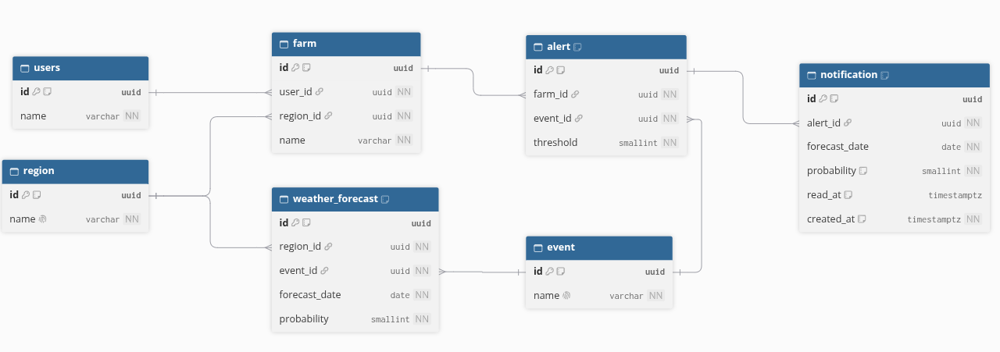

# alertas-climaticas
Sistema de Alertas Climaticas. Servicio HTTP construido con Python, FastAPI y PostgreSQL que permite a los usuarios configurar alertas sobre sus campos y ser notificados cuando el pronostico de los proximos 7 dias supera el umbral definido.

## API

## Requerimientos

### Requerimientos Funcionales
- Un usuario debe poder cargar su campo con sus datos, asociandolo a una region (CRUD completo)
- Un usuario debe poder configurar las alertas que quiera sobre su campo (CRUD completo). Cada alerta tiene un tipo de evento climatico y un umbral de probabilidad
- El sistema debe evaluar periodicamente (background job) los datos meteorologicos de los proximos 7 dias contra los umbrales de cada alerta, y generar notificaciones cuando se superan
- Un usuario debe poder consultar sus notificaciones a traves de un endpoint y marcarlas como leidas

### Requerimientos No Funcionales
- **Sin duplicados:** una alerta no notifica dos veces el mismo evento del mismo dia, aunque el job se ejecute varias veces (idempotencia)
- **Sin falsos negativos:** si la probabilidad alcanza el umbral, se notifica
- **Seguro ante concurrencia:** dos ejecuciones simultaneas del job no generan notificaciones repetidas
- **Asincronico:** API y acceso a base de datos async (FastAPI + SQLAlchemy async)
- **Procesamiento desacoplado:** la evaluacion de alertas corre en un background job independiente de las requests, por lo que ningun endpoint espera a que se evalue
- **Validacion y errores claros:** umbral entre 0 y 100, tipos de evento validos, 404 cuando un recurso no existe
- **Reproducible:** migraciones con Alembic, tests automatizados y ejecucion con Docker

### Fuera de alcance
- Integracion con WhatsApp
- Autenticacion y autorizacion
- Ingesta real de datos meteorologicos (los datos se mockean)

## Decisiones Tomadas

La consigna deja varios puntos abiertos. Estas son las decisiones adoptadas:

| Tema | Decision | Justificacion |
|---|---|---|
| Ubicacion del campo | Cada campo pertenece a una **region**, no a coordenadas | Los servicios meteorologicos no tienen precision por lat/lon exactas, y modelar coordenadas agrega datos y logica innecesarios para este alcance |
| Horizonte de evaluacion | El job evalua **7 dias hacia adelante** e informa los dias en que se supera el umbral | Alineado con un pronostico semanal |
| Eventos soportados | Lluvia, helada, tormenta (rayos y granizo) y calor extremo | Cubren los riesgos agricolas principales. La lista final se fija al definir el esquema |
| Condicion de disparo | Se notifica cuando la probabilidad es **mayor o igual** al umbral | La consigna dice "a partir del cual desean ser notificados", lo que sugiere un umbral inclusivo |
| Granularidad de notificacion | Una notificacion por alerta y dia del evento | La clave unica (alerta, fecha) garantiza que no haya duplicados aunque el job corra varias veces |
| Recordatorios | No se reenvia el aviso a medida que el evento se acerca | El aviso del dia 6 no aporta informacion nueva respecto al del dia 7. Si el usuario recibe una notificación diaria por el mismo evento, aprende a ignorarlas Cada notificacion significa "hay algo nuevo" |
| Cambios en el pronostico | Si la probabilidad cambia despues de notificar, no se vuelve a avisar | Requeriria guardar el valor notificado y definir que es un cambio relevante. Queda como mejora futura |
| Valor informado | Probabilidad del evento | La consigna indica que los datos almacenados son probabilidades. Una mejora futura seria adaptar otro valor (ej: cantidad de milimetros de lluvia, temperatura, etc) |
| Usuarios | Identificados por un `user_id` simple, sin autenticacion | Fuera de alcance del challenge |
| Datos meteorologicos | Mockeados mediante seed | La consigna indica que la ingesta ya existe |
| Notificacion al usuario | El job genera la notificacion en la base de datos. El usuario puede hacer una consulta por endpoint, sin integracion con WhatsApp | Lo indica la consigna |

## Modelo de Datos



El codigo DBML que genera el diagrama esta al final de este documento ([Anexo](#anexo-codigo-dbml)).

| Tabla | Columnas | Restricciones |
|---|---|---|
| `region` | `id` UUID PK, `name` | `name` unico |
| `users` | `id` UUID PK, `name` | |
| `farm` | `id` UUID PK, `user_id` FK, `region_id` FK, `name` | |
| `event` | `id` UUID PK, `name` | `name` unico |
| `weather_forecast` | `id` UUID PK, `region_id` FK, `event_id` FK, `forecast_date` DATE, `probability` SMALLINT | unico `(region_id, event_id, forecast_date)`, `CHECK` de 0 a 100 |
| `alert` | `id` UUID PK, `farm_id` FK, `event_id` FK, `threshold` SMALLINT | unico `(farm_id, event_id)`, `CHECK` de 0 a 100 |
| `notification` | `id` UUID PK, `alert_id` FK, `forecast_date` DATE, `probability` SMALLINT, `read_at` TIMESTAMPTZ nulo, `created_at` TIMESTAMPTZ | unico `(alert_id, forecast_date)` |

### Decisiones del modelo
- **UUID como clave primaria:** para parecerse a un entorno de produccion. Se generan con `gen_random_uuid()`, incluido en PostgreSQL desde la version 13.
- **Tabla `event` en lugar de enum:** agregar un tipo de evento es insertar una fila, sin migrar el esquema. Los eventos se identifican por `name` (unico).
- **`probability` y `threshold` como `SMALLINT`:** enteros de 0 a 100, sin `float`, para que la comparacion `>=` sea exacta.
- **`forecast_date` como `DATE`:** el pronostico es por dia calendario. Un `TIMESTAMP` obligaria a elegir una hora y una zona horaria, lo que puede correr el dia segun quien lo lea y romper la clave unica `(region_id, event_id, forecast_date)`.
- **`notification` guarda un snapshot de `probability`:** si el pronostico cambia despues, la notificacion enviada no se modifica.
- **`read_at` nulo en lugar de un boolean:** nulo significa "no leida" y ademas se sabe cuando se leyo.
- **Tabla `users` en plural:** `user` es palabra reservada en PostgreSQL.
- **Borrado:** eliminar una `farm` elimina en cascada sus alertas y notificaciones. Eliminar una `region` con campos asociados se rechaza (`RESTRICT`).

## Seed de Datos Meteorologicos

La consigna indica que la ingesta meteorologica ya existe, por lo que el clima se mockea con un script: `src/alertas_climaticas/seed.py`.

### Que carga
- **10 regiones** de la provincia de Buenos Aires: Mercedes, Tandil, Navarro, Pergamino, Balcarce, Trenque Lauquen, San Pedro, Cañuelas, Tres Arroyos y Lobos
- **4 eventos:** lluvia, helada, calor extremo y tormenta
- **Un pronostico por region, evento y dia** para 30 dias (desde hoy), con probabilidades en pasos de 20: 0, 20, 40, 60, 80 y 100. Son 1200 filas (10 x 4 x 30)

No carga usuarios, campos ni alertas: se crean con los endpoints de la API.

### Como se generan los valores
Para que el clima sea verosimil, los valores no son totalmente aleatorios:

| Regla | Como se implementa |
|---|---|
| Calor extremo y helada no pueden ser altos a la vez | Cada dia se sortea un **estado termico** (calido 30%, frio 30%, templado 40%). En un dia calido el calor es 60, 80 o 100 y la helada 0. En un dia frio ocurre lo inverso. En un dia templado ambos son 0, 20 o 40 |
| Los dias seguidos se parecen | El estado termico se conserva con un 60% de probabilidad. Si no, se vuelve a sortear |
| Lluvia y tormenta estan correlacionadas, pero no siempre | La lluvia favorece valores bajos. El 70% de las veces la tormenta se deriva de la lluvia (igual o uno o dos escalones menos, nunca mas). El 30% restante es independiente y con valores bajos |

La regla de calor y helada se cumple **por construccion**: los valores se generan de modo que no puedan violarla, en lugar de generarlos y descartar los invalidos.

### Decisiones
- **Semilla fija (`random.Random(42)`):** el seed genera siempre los mismos valores, lo que facilita reproducir problemas
- **Idempotente:** se puede ejecutar varias veces sin error. Inserta con `ON CONFLICT DO NOTHING`, apoyado en las claves unicas del modelo
- **No es una migracion:** las migraciones definen el esquema, y estos datos son solo para desarrollo y pruebas
- **Generacion separada de la insercion:** las funciones que generan los valores no tocan la base, lo que permite testearlas por separado

### Ejecutar
Requiere la base levantada y las migraciones aplicadas (`uv run alembic upgrade head`):

```
uv run python -m alertas_climaticas.seed
```

### Volver a ejecutarlo
- **El mismo dia:** no duplica ni falla. Las filas existentes se conservan
- **Otro dia, o con otra cantidad de dias:** solo inserta las fechas que faltan. Las filas existentes **no se actualizan**, y los dias nuevos se generan con una secuencia aleatoria distinta, por lo que puede haber un salto en la continuidad entre los dias viejos y los nuevos
- **Para regenerar todo de forma coherente:** vaciar la tabla y volver a ejecutar
  ```
  docker exec alertas-db psql -U alertas -d alertas -c "TRUNCATE weather_forecast"
  uv run python -m alertas_climaticas.seed
  ```

### Validar
Cantidad de filas (esperado: 1200) y valores posibles (esperado: 0, 20, 40, 60, 80, 100):
```sql
SELECT count(*) FROM weather_forecast;
SELECT DISTINCT probability FROM weather_forecast ORDER BY 1;
```

Dias en que calor extremo y helada son incompatibles (esperado: 0):
```sql
SELECT count(*)
FROM weather_forecast heat
JOIN event eh ON eh.id = heat.event_id AND eh.name = 'calor extremo'
JOIN weather_forecast frost
  ON frost.region_id = heat.region_id AND frost.forecast_date = heat.forecast_date
JOIN event ef ON ef.id = frost.event_id AND ef.name = 'helada'
WHERE (heat.probability >= 60 AND frost.probability > 0)
   OR (frost.probability >= 60 AND heat.probability > 0);
```

## Background Job de notificacion de alertas

El job evalua los pronosticos contra las alertas y genera las notificaciones. La logica esta en `services/evaluation.py` (`evaluate_alerts`).

### Como funciona
1. Toma una ventana de **7 dias**: desde hoy hasta hoy + 6
2. Cruza cada alerta con el pronostico de la region de su campo, para el mismo evento
3. Crea una notificacion por cada **alerta y dia** en que la probabilidad es **mayor o igual** al umbral
4. Devuelve la cantidad de notificaciones nuevas

Todo se resuelve en una unica consulta, sin recorrer las alertas una por una:

```sql
INSERT INTO notification (alert_id, forecast_date, probability)
  SELECT a.id, wf.forecast_date, wf.probability
  FROM alert a
  JOIN farm f ON f.id = a.farm_id
  JOIN weather_forecast wf ON wf.region_id = f.region_id AND wf.event_id = a.event_id
  WHERE wf.forecast_date BETWEEN :desde AND :hasta
    AND wf.probability >= a.threshold
  ORDER BY a.id, wf.forecast_date
  ON CONFLICT (alert_id, forecast_date) DO NOTHING
  RETURNING id
```
`:desde` es hoy y `:hasta` es hoy + 6. Los pasa la aplicacion como parametros. `RETURNING id` devuelve los ids de las notificaciones creadas, sin incluir las que `ON CONFLICT` ignoro.

### Garantias
- **Sin duplicados:** `ON CONFLICT DO NOTHING` sobre la clave unica `(alert_id, forecast_date)` (restriccion `uq_notification_alert_date`). Ejecutar el job varias veces, o dos a la vez, crea cada notificacion una sola vez
- **Sin deadlocks:** el `ORDER BY` hace que toda ejecucion inserte las filas en el mismo orden, por lo que dos ejecuciones simultaneas no se bloquean entre si
- **Snapshot:** la notificacion guarda la probabilidad del momento. Si el pronostico cambia despues, no se vuelve a avisar ni se modifica

### Ejecucion periodica
El job se programa con **APScheduler** (`AsyncIOScheduler`) dentro del `lifespan` de la app: arranca junto con la API y se detiene al apagarla. Se ejecuta como una tarea aparte, por lo que ningun endpoint espera a que se evalue. Corre **una vez por dia, a las 6:00 hora Argentina**.

- **Una vez por dia:** a las 6:00 (`EVALUATION_HOUR`, en la zona `TIMEZONE`), con un disparador `cron` de APScheduler. Una alerta creada durante el dia se evalua en la corrida de la manana siguiente
- **Al arrancar no corre:** si la app estaba apagada a las 6:00, esa corrida no se recupera (el scheduler no guarda estado). Se puede forzar a mano, ver abajo
- **`max_instances=1`:** nunca hay dos evaluaciones a la vez en el proceso
- **`coalesce`:** si se acumulan corridas atrasadas, se ejecuta una sola
- **Errores:** un fallo (por ejemplo, la base no responde) se registra con su detalle y no detiene las siguientes corridas. La siguiente es el reintento
- **"Hoy":** se calcula en la zona `TIMEZONE`, no en la del servidor. Los pronosticos son por dia de campos en Buenos Aires, y con UTC la ventana quedaria corrida un dia entre las 21:00 y las 24:00
- **Aislamiento:** el scheduler corre en el mismo proceso que la API. Separarlo en un proceso propio esta en [Mejoras](#mejoras)

| Variable | Por defecto | Que controla |
|---|---|---|
| `EVALUATION_JOB_ENABLED` | `true` | Si la app arranca el job. En `.env.test` es `false` |
| `EVALUATION_HOUR` | `6` | Hora del dia (0 a 23) a la que corre, en la zona `TIMEZONE` |
| `TIMEZONE` | `America/Argentina/Buenos_Aires` | Zona que define "hoy". Se valida al arrancar |

En los logs de la app se ve cada corrida: `Alert evaluation for 2026-10-25 created 7 notifications`.

### Ejecutar una evaluacion a mano
Sirve para probar sin esperar a las 6:00, o para recuperar una corrida perdida. Evalua una vez, muestra cuantas notificaciones creo y termina:

```
uv run python -m alertas_climaticas.jobs.alert_evaluation
```
Es seguro ejecutarlo cuando se quiera, incluso con la API corriendo: no duplica notificaciones.

## Notificaciones

Cada usuario consulta sus notificaciones con dos endpoints. En ambos solo se consideran las de **hoy en adelante** (por la fecha del pronostico, en la zona `TIMEZONE`): las de dias pasados ya no sirven y no se devuelven ni se modifican.

| Endpoint | Que hace |
|---|---|
| `GET /notifications?user_id=...` | Historial desde hoy. **No modifica nada.** `read=false` deja solo las no leidas, `read=true` solo las leidas |
| `POST /notifications/consume?user_id=...` | Devuelve las notificaciones **nuevas** (sin leer, desde hoy) y las marca como leidas en el mismo paso |

El cliente (por ejemplo, el bot de WhatsApp) llama a `consume` y recibe solo lo nuevo, sin un segundo paso para marcarlas. El `GET` queda libre de efectos secundarios, como corresponde a este metodo HTTP, y sirve para ver el historial.

Cada notificacion trae los datos y el mensaje ya armado:

```json
{
  "id": "…", "alert_id": "…",
  "farm_name": "La Esperanza", "event": "lluvia",
  "forecast_date": "2026-10-28", "probability": 80,
  "read": false, "read_at": null, "created_at": "…",
  "message": "Alerta de lluvia en La Esperanza: 80% de probabilidad el 28/10/2026"
}
```
El mensaje no incluye el umbral: la alerta se puede editar despues y el texto quedaria inexacto.

- **Una sola entrega por notificacion:** `consume` es un unico `UPDATE ... WHERE read_at IS NULL ... RETURNING`. Si dos consumidores piden a la vez, PostgreSQL le entrega cada notificacion a uno solo
- **Sin control de duenio:** como no hay autenticacion, el usuario se indica con `user_id`. Un usuario inexistente devuelve una lista vacia

## Compilar y ejecutar

### Local

#### Requisitos
- Python 3.12 o superior
- [uv](https://docs.astral.sh/uv/) (gestor de dependencias)
- Docker (para PostgreSQL)

#### Pasos

1. **Instalar las dependencias**
   ```
   uv sync
   ```

2. **Levantar PostgreSQL**
   ```
   docker run -d --name alertas-db \
     -e POSTGRES_USER=alertas -e POSTGRES_PASSWORD=alertas -e POSTGRES_DB=alertas \
     -p 5433:5432 -v alertas-pgdata:/var/lib/postgresql/data postgres:16
   ```
   Se publica en el puerto **5433** del host para no chocar con un PostgreSQL instalado en el sistema, que suele usar el 5432. Los datos quedan en el volumen `alertas-pgdata`, por lo que sobreviven si se borra el contenedor.

   Si ya existe pero esta detenido (por ejemplo, despues de reiniciar la maquina): `docker start alertas-db`.

3. **Configurar las variables de entorno**
   ```
   cp .env.example .env
   ```
   El `.env.example` ya apunta al contenedor del paso anterior. El `.env` no se sube a git. Variables:

   | Variable | Por defecto | Que controla |
   |---|---|---|
   | `DB_HOST` | `localhost` | Host de PostgreSQL |
   | `DB_PORT` | `5432` | Puerto de PostgreSQL (en `.env.example` es `5433`, el del contenedor) |
   | `DB_USER` | obligatoria | Usuario de la base |
   | `DB_PASSWORD` | obligatoria | Contrasena de la base. Puede tener caracteres especiales (`@`, `/`, `%`) |
   | `DB_NAME` | obligatoria | Nombre de la base |
   | `HOST` | `0.0.0.0` | Interfaz en la que escucha la API (la usa uvicorn, no la app) |
   | `PORT` | `8000` | Puerto de la API (la usa uvicorn, no la app) |

   La app arma la URL de conexion a partir de las piezas `DB_*`. Las variables del job (`TIMEZONE`, `EVALUATION_*`) estan en [Background Job](#background-job-de-notificacion-de-alertas).

4. **Aplicar las migraciones**
   ```
   uv run alembic upgrade head
   ```

5. **Cargar los datos meteorologicos mockeados** (ver [Seed de Datos Meteorologicos](#seed-de-datos-meteorologicos))
   ```
   uv run python -m alertas_climaticas.seed
   ```

6. **Levantar la API**
   ```
   uv run uvicorn alertas_climaticas.main:app --reload
   ```
   `--reload` reinicia el servidor cada vez que se guarda un cambio. Es util para desarrollar y se puede omitir.

#### Ver la documentacion de la API (Swagger)

Con la API corriendo, abrir en el navegador:

| URL | Que es |
|---|---|
| http://localhost:8000/docs | Swagger UI: lista los endpoints y permite probarlos desde el navegador |
| http://localhost:8000/redoc | La misma documentacion en formato de lectura (ReDoc) |
| http://localhost:8000/openapi.json | El esquema OpenAPI en JSON |

Las paginas `/docs` y `/redoc` cargan sus archivos desde un CDN, por lo que necesitan conexion a internet y que ningun bloqueador del navegador los frene. Si la pagina queda en blanco, `/openapi.json` y los endpoints siguen funcionando.

**Flujo de prueba en Swagger:**
1. `POST /users` con `{"name": "Mateo"}` y copiar el `id` de la respuesta (si el usuario ya existe, `GET /users` lista los ids)
2. `GET /regions` y copiar el `id` de una region
3. `POST /farms` con `user_id`, `region_id` y `name`
4. `GET /farms/{farm_id}` con el `id` del campo creado

#### Ejecutar los tests
Ver la seccion [Tests](#tests).

### Docker

## Tests

Los tests de integracion usan una base PostgreSQL **separada** (`alertas_test`), para no tocar los datos de desarrollo.

### Requisitos
- **PostgreSQL levantado** en el host y puerto de `.env.test`. Con Docker: `docker start alertas-db`
- Dependencias instaladas: `uv sync`

### Ejecutar
```
uv run pytest                  # todos los tests
uv run pytest -m "not db"      # solo los que no necesitan la base
```

### Como funcionan
- `tests/conftest.py` lee `.env.test`, crea `alertas_test` si no existe, la recrea vacia y aplica `alembic upgrade head`. Cada corrida prueba tambien las migraciones desde cero
- Despues de cada test se vacian las tablas, por lo que ningun test depende de otro
- Los tests que usan la base se marcan solos con `db`
- **Si la base no esta disponible**, solo un test falla, con un mensaje que explica la causa (host, puerto y error). Los demas tests que usan la base se omiten, y los que no la usan se ejecutan igual
- **Salvaguarda:** el nombre de la base de tests debe terminar en `_test`. El fixture borra todo el esquema, y asi nunca puede apuntar a la base de desarrollo

## Estructura del Sistema


## Mejoras

Cosas que quedaron fuera de alcance a proposito, para mantener el challenge simple:

- **Job en un proceso aparte:** hoy el scheduler corre dentro de la API. Un worker propio (por ejemplo, otro contenedor que reutilice `run_evaluation`) aislaria el job de la API, que podria reiniciarse o escalar sin afectarlo
- **Recuperar la corrida perdida:** si la app esta apagada a las 6:00, hoy se espera a la manana siguiente. Un almacen de jobs persistente o una evaluacion al arrancar lo resolverian
- **Guardar el resultado de cada corrida del job:** hoy el resultado (cuantas notificaciones se crearon, o el error) solo sale en los logs, que no se conservan. Registrar cada ejecucion (fecha, duracion, cantidad creada, error) en una tabla o en un archivo de logs rotado daria trazabilidad del flujo y permitiria saber si una corrida de las 6:00 se perdio o fallo
- **Confirmar la entrega antes de marcar como leida:** `POST /notifications/consume` marca las notificaciones al devolverlas. Si la respuesta se pierde en el camino, el usuario no la recibe y queda como leida (entrega "a lo sumo una vez"). Una confirmacion explicita del cliente (por ejemplo, un `PATCH` despues de enviar el mensaje por WhatsApp) daria entrega "al menos una vez"
- **Paginacion de notificaciones** y limpieza de las vencidas: hoy se filtran por fecha pero siguen guardadas
- **Advisory lock:** con varias instancias de la API, cada una corre el job. No genera duplicados (lo evita `ON CONFLICT`), pero repite trabajo. Un lock de PostgreSQL (`pg_try_advisory_lock`) haria que solo una instancia evalue
- **Re-notificar cambios importantes del pronostico:** si la probabilidad sube mucho despues de avisar, hoy no se vuelve a notificar
- **Umbrales por magnitud:** ademas de la probabilidad, alertar por milimetros de lluvia o grados de temperatura
- **Autenticacion y autorizacion:** hoy el usuario se identifica con su `id` y cualquiera puede consultar o modificar cualquier recurso
- **Paginacion** en los listados (`GET /users`, `GET /farms`, `GET /alerts`)

## Anexo: Codigo DBML

Codigo para regenerar el diagrama en [dbdiagram.io](https://dbdiagram.io/d).

```dbml
Table region {
  id uuid [pk, default: `gen_random_uuid()`]
  name varchar [not null, unique]
}

Table users {
  id uuid [pk, default: `gen_random_uuid()`]
  name varchar [not null]
}

Table event {
  id uuid [pk, default: `gen_random_uuid()`]
  name varchar [not null, unique]
}

Table farm {
  id uuid [pk, default: `gen_random_uuid()`]
  user_id uuid [not null]
  region_id uuid [not null]
  name varchar [not null]
}

Table weather_forecast {
  id uuid [pk, default: `gen_random_uuid()`]
  region_id uuid [not null]
  event_id uuid [not null]
  forecast_date date [not null]
  probability smallint [not null]

  indexes {
    (region_id, event_id, forecast_date) [unique]
  }

  checks {
    `probability BETWEEN 0 AND 100`
  }
}

Table alert {
  id uuid [pk, default: `gen_random_uuid()`]
  farm_id uuid [not null]
  event_id uuid [not null]
  threshold smallint [not null]

  indexes {
    (farm_id, event_id) [unique]
  }

  checks {
    `threshold BETWEEN 0 AND 100`
  }
}

Table notification {
  id uuid [pk, default: `gen_random_uuid()`]
  alert_id uuid [not null]
  forecast_date date [not null]
  probability smallint [not null, note: 'Snapshot del valor al momento de notificar']
  read_at timestamptz [null, note: 'Nulo significa no leida']
  created_at timestamptz [not null, default: `now()`]

  indexes {
    (alert_id, forecast_date) [unique]
  }
}

Ref: farm.user_id > users.id
Ref: farm.region_id > region.id [delete: restrict]
Ref: weather_forecast.region_id > region.id
Ref: weather_forecast.event_id > event.id
Ref: alert.farm_id > farm.id [delete: cascade]
Ref: alert.event_id > event.id
Ref: notification.alert_id > alert.id [delete: cascade]
```
